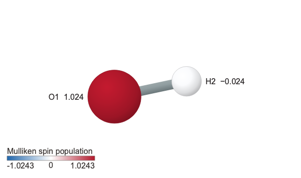

# OrcaView

OrcaView is a desktop application and command-line interface for preparing ORCA inputs and examining calculation results. Draw a molecule, edit its input, then open an ORCA output to inspect the calculated geometry, plot spectra or map atomic populations. Each imported population is associated with its atoms, geometry and source lines.

**Version 0.1.0a61** adds atomic population maps, element-resolved NMR plots and editable `MiniPrint` and `NoAutoStart` input settings. [Release notes and downloads](https://github.com/lightzfpwings/OrcaView/releases/tag/v0.1.0a61)

## Install

| Platform | Package | Launch |
| --- | --- | --- |
| Windows x64 | [Portable ZIP](https://github.com/lightzfpwings/OrcaView/releases/download/v0.1.0a61/OrcaView-0.1.0a61-Windows-x64-portable.zip) | Extract into a dedicated folder and open `OrcaView.exe`. |
| macOS on Apple Silicon | [Disk image](https://github.com/lightzfpwings/OrcaView/releases/download/v0.1.0a61/OrcaView-0.1.0a61.macOS-arm64.dmg) | Drag `OrcaView.app` into Applications. Copy `Examples/` to a writable folder. |
| Linux x86-64 | [Portable tar.gz](https://github.com/lightzfpwings/OrcaView/releases/download/v0.1.0a61/OrcaView-0.1.0a61-Linux-x86_64.tar.gz) | Extract and run `./OrcaView` from the extracted folder on a graphical desktop. |

All three packages include Python, Qt, Open Babel and 21 example files. Drawing structures, generating inputs and reading existing results work offline. Running a new calculation requires a separate ORCA installation. The local job runner supports macOS and Linux. The macOS app uses an ad hoc signature. [SHA-256 checksums](https://github.com/lightzfpwings/OrcaView/releases/download/v0.1.0a61/SHA256UMS.txt) · [macOS opening instructions](https://support.apple.com/en-us/102445)

English is built in. The language pack adds German, Japanese, Simplified Chinese and Traditional Chinese. The color pack provides Contrast, Pastel and Grayscale element palettes. [Language pack](https://github.com/lightzfpwings/OrcaView/releases/download/v0.1.0a61/OrcaView-Extensions-01-Language-0.1.0a61.zip) · [Color pack](https://github.com/lightzfpwings/OrcaView/releases/download/v0.1.0a61/OrcaView-Extensions-02-Color-0.1.0a61.zip) · [Installation and authoring](docs/extensions/README.md)

## Atomic populations in the hydroxyl radical

Open `Examples/hydroxyl-populations.out`. In **Result**, click **Atomic populations…** and select **Mulliken spin population**. For this unrestricted PBE/def2-SVP doublet, ORCA reports +1.024339 for oxygen and −0.024339 for hydrogen. Their sum is 1.000000. Labels display the signed values and the legend shows the range used to color the atoms. [ORCA input and output](examples/populations/hydroxyl.out)



Switch between Mulliken, Löwdin, Hirshfeld and MBIS partitions when the output contains them. CHELPG supplies fitted charges. Choose red–white–blue, blue–white–red, rainbow or black–white, edit individual colors, or save a preset. Fixed limits and a midpoint let you compare the same quantity across structures. [Population definitions and ORCA log coverage](docs/ORCA_LOG_COVERAGE.md)

From a source checkout with the GUI dependencies installed, these commands export the numerical table and reproduce the figure above.

```sh
orcaview results examples/populations/hydroxyl.out --dataset mulliken-spin --format csv -o spin.csv
orcaview render examples/populations/hydroxyl.out spin.png --population mulliken-spin \
  --population-scale bwr --population-symmetric --labels --rotate y:76 --rotate z:12 \
  --zoom 1.65 --width 600 --height 355
```

## Spectra

Open `Examples/water-nmr.out` and choose **NMR chemical shielding**. Both hydrogens in this calculation have an isotropic shielding of 31.130 ppm and contribute to one peak with weight two. To plot chemical shifts, enter a reference shielding for the same element and method. OrcaView plots δ = σref − σ in ppm. The one-dimensional spectrum uses uncoupled sites. **NMR spin–spin coupling** plots signed J values by atom pair in Hz. [Water NMR output](artifacts/public/validation/results-0.1.0a12/nmr/water-shield.out)

For IR and Raman, try `Examples/water-raman.out`. For UV/Vis absorption and signed circular dichroism, try `Examples/peroxide-uv-cd.out`. **Plot settings…** controls the axis units, line shape, full width at half maximum and stick overlay. Export the displayed figure as PNG, JPEG, BMP or vector PDF, or save the sticks and sampled curve as CSV. [Spectrum example](artifacts/public/spectrum-plot.png) · [CLI commands and export formats](docs/CLI_RESULTS.md)

## Geometry and ORCA input

The **Design** workspace pairs a 2D sketch with a 3D geometry. Add rings or hydrogens, edit bonds and coordinates, and optimize a starting geometry with Open Babel's MMFF94 or UFF force field. Import structures from XYZ, MOL/SDF, PDB and other formats. [Design commands](docs/CLI_DESIGN.md) · [Open Babel force fields](https://openbabel.org/docs/Forcefields/Overview.html)

In **Input**, choose a method, basis set, charge and multiplicity, or edit the ORCA input preview and press Tab to apply it. For example, `! MiniPrint NoAutoStart` requests minimal output and disables automatic reuse of a same-name orbital file for a single-point calculation. The corresponding panel controls are `%output → PrintLevel` and `%scf → AutoStart`. [Supported methods and input blocks](docs/ORCA_METHODS.md) · [Native ORCA input examples](examples/native_methods/)

## Source and validation

The core and CLI support Python 3.9 and later. In a virtual environment, run the following commands from the repository root.

```sh
python -m pip install -e ".[gui]"
python -m orcaview gui
python tools/run_tests.py -q
```

The regression suite combines the archived test set with tests in this checkout. The validation record includes reference ORCA 6.1.1 outputs and package checks for individual releases. Desktop builds use CPython 3.13. Windows packaging requires Go 1.23 or later. On Apple Silicon, install PyInstaller 6.22.3 and run `python packaging/macos/build.py`. [Validation record](docs/PUBLIC_VALIDATION.md) · [Linux and Windows build instructions](packaging/desktop/README.md) · [Batch CLI guide](docs/CLI.md)

Use **Help → Check for Updates…** for subsequent releases. On macOS, versions through 0.1.0a55 require a one-time manual replacement from the DMG. On Windows, versions through 0.1.0a42 require a one-time manual installation of the single-file package.

For a paper using OrcaView, cite the software version used to prepare the inputs or figures and report the ORCA version and electronic-structure settings for the calculation. [Software citation](CITATION.cff)

OrcaView is distributed under the MIT license. Bundled third-party libraries have their own licenses. [License](LICENSE) · [Third-party notices and sources](THIRD_PARTY_NOTICES.md)
