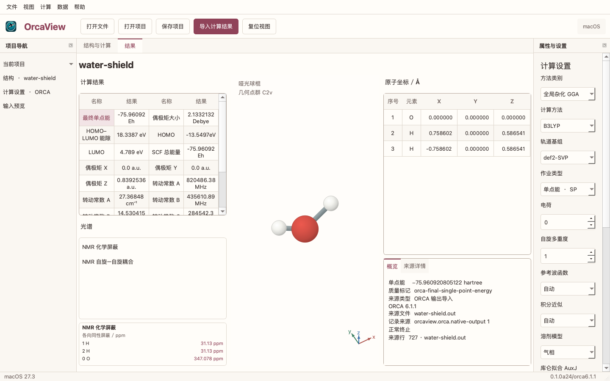

# OrcaView

OrcaView 是面向 ORCA 的开源桌面前后处理工具。可以打开分子结构、编辑和导出 ORCA 输入，并从已有计算日志查看能量、电荷、分子轨道和光谱结果。

当前公开预发行版为 **0.1.0a43**。输入模板按 **ORCA 6.1.1** 编制。



## 下载

| 平台 | 下载与启动方式 |
|---|---|
| Windows x64 | [下载 Windows ZIP](https://github.com/lightzfpwings/OrcaView/releases/download/v0.1.0a43/OrcaView-0.1.0a43-Windows-x64-portable.zip)，完整解压后双击 `OrcaView.exe`。 |
| Linux x86-64 | [下载 Linux tar.gz](https://github.com/lightzfpwings/OrcaView/releases/download/v0.1.0a43/OrcaView-0.1.0a43-Linux-x86_64.tar.gz)，解压后进入程序目录，在图形桌面中运行 `./OrcaView`。 |
| macOS（Apple Silicon，arm64） | [下载 macOS DMG](https://github.com/lightzfpwings/OrcaView/releases/download/v0.1.0a43/OrcaView-0.1.0a43-macOS-arm64.dmg)，打开后将 `OrcaView.app` 拖入「应用程序」。 |

Windows ZIP 的根目录有仅含 `OrcaView.exe`、`LICENSE` 和 `Examples/`。双击 EXE 即可启动。三个平台都提供 20 份分子结构、ORCA 输入和结果示例。macOS 与 Linux 的示例目录名为「示例」。三个平台均内置 Python、Qt 和 Open Babel。浏览结构、生成输入及查看已有计算结果可直接离线使用。运行新的量子化学计算需另行安装 ORCA。Windows 版支持生成和导出输入，应用内的本地作业运行器当前使用 POSIX 进程控制。[发行页与 SHA-256 校验清单](https://github.com/lightzfpwings/OrcaView/releases/tag/v0.1.0a43)

macOS 试用版使用临时签名，未经 Apple 公证。首次打开下载的应用时如出现系统提示，请参阅 [Apple 的打开说明](https://support.apple.com/zh-cn/102445)。

### 在软件内检查更新

使用 0.1.0a37 或更高版本时，打开 **帮助 → 检查更新…** 即可查询 GitHub 发行版。更早的版本可从上表下载安装。稳定版只提示新的稳定版，预发行版也会提示更新的预发行版。程序按操作系统和处理器选择安装包，下载完成后校验 SHA-256。

Windows 0.1.0a42 及更早版本首次转到单文件版时，请在旧版更新窗口点击 **GitHub 发布页**（或直接使用上表的 Windows 下载链接），将新版解压到单独的文件夹后启动。原项目可从新版直接打开。要沿用旧快捷方式，先退出旧版，将原程序目录重命名为备份，然后把新版解压到原路径。个人项目和改过的示例仍在备份目录中。

Windows 单文件版、macOS 和 Linux 的原位置更新入口是 **帮助 → 检查更新… → 下载并覆盖安装…**。保存项目后点击 **退出并更新**，新版会在原位置重启。Windows 和 Linux 会在同级 `.previous` 目录备份旧程序，保留项目以及用户自建或修改过的示例。macOS 与 Linux 从 0.1.0a42 起支持覆盖更新。[GitHub 发行记录](https://github.com/lightzfpwings/OrcaView/releases)

### 在 Windows 上试用

1. 完整解压 ZIP，在解压后的程序目录中双击 `OrcaView.exe`。所需的 Python、Qt 和 Open Babel 运行库都已封装在 EXE 内。
2. 在 OrcaView 中按 **Ctrl+O**，选取安装包里的 `Examples/water.xyz`。视口应显示一个氧原子和两个氢原子，底部「ORCA 输入预览」可查看原生输入。
3. 要测试结果导入，可按 **Ctrl+O** 打开安装包里的 `Examples/water-sp.out`。在「结果」页可核对示例单点能 −76.123456789012 Eh、Mulliken 电荷与原子坐标。

程序窗口标题和 **帮助 → 检查更新…** 均可查看当前版本。[分平台验证记录](docs/PUBLIC_VALIDATION.md)

从 0.1.0a40 起，Windows 简体中文界面优先使用微软雅黑 UI，繁体中文优先使用微软正黑体 UI。字体提供细体时，正文使用细体，标题与表头使用常规字重。预览与坐标沿用等宽排版，显示大小跟随 Windows 的缩放比例。

## 支持的工作流

- **分子结构**：支持 XYZ、MOL/SDF、MOL2、PDB、CML、CDXML、SMILES、InChI 等格式。二维结构可通过内置 Open Babel 生成三维构象。识别到周期性结构时，程序会询问是否去掉周期性。
- **量子化学文件**：支持 Gaussian、ORCA、Q-Chem 和 NWChem 输入；可从 Molden、FCHK、WFN、WFX、MWFN 等文件读取原子坐标。读取 ORCA 二进制 GBW 需匹配版本的 `orca_2mkl`。
- **结构视图**：显示哑光球棍及几何点群，并将最高阶旋转轴对齐显示坐标系的 z 轴。载入和复位都从 +z 俯视，x 向右、y 向上。结构页和结果页共用带箭头的坐标轴，⊙ 表示正轴朝向观察者，⊗ 表示正轴远离观察者。原子表及导出文件保留源坐标。在结果页选中两个原子可查看键长。
- **旋转与平移（0.1.0a28）**：在「复位视图」旁输入旋转角度（默认 15°，支持小数），每点一次箭头图标，当前视图就旋转该角度。悬停可查看各图标的旋转方向。按住鼠标左键拖动可自由旋转，按住右键拖动可平移，滚轮可缩放。单击原子可选择，点击「复位视图」可恢复初始方向、居中和缩放。
- **计算输入**：配置方法、基组、计算任务、电荷和自旋多重度，可编辑高级输入块、预览和导出原生 `.inp`。生成的输入中，原子坐标统一保留 8 位小数。[计算方法说明](docs/ORCA_METHODS.md)
- **计算结果**：从 ORCA `.out` 或 `.log` 中提取实际打印的能量、HOMO/LUMO、偶极矩、布居电荷、振动和 NMR 等数据。只读结果表可复制，详情可回查源文件及行号。

「输入」工作区底部有三个页签。「ORCA 输入预览」随计算设置实时更新，「结果摘要」显示通过 **文件 → 读取 ORCA 输出摘要…** 读入的内容，「消息与日志」记录操作消息。

## 在「设计」里编辑分子

打开结构后切到「设计」，左边是可编辑的二维草图，右边是同一分子的三维预览。两栏默认等宽，可以拖动中间的分隔线调整，双击分隔线恢复等宽。「新建分子」从一个碳原子起步。可以删除所有原子，撤销可恢复上一步的结构。清空后用「原子」工具或环模板点击画布即可重新绘制。此时切到「输入」或「结果」，选择「是」会返回设计，选择「否」会留在没有可选项的当前页。

1. 点击当前元素符号展开周期表。可直接点选，也可输入元素符号或原子序数，例如输入 Fe 或 26 后按回车选铁。选好键型，从原子拖到空白处即可添加原子并成键。点击已有键线可修改键级，用「原子」工具点击已有原子可替换元素。单、双、三键按钮默认选用常规键，点右箭头可切换样式。单键可选配位虚线、供体指向受体的箭头或楔形等画法，双键可选一实一虚的芳香键（1.5）或构型未指定的交叉双键，三键可选两实一虚的部分三键（2.5）。
2. 点击工具栏上的小苯环图标或右侧箭头，选择 3 至 8 元碳环或苯环。菜单中的勾号标出当前模板。点击新建分子的起始碳，会以它为环的一个顶点。点击已有结构的原子，会用单键接出一个环。点击空白处会放置独立的环。模板生成平面碳骨架，氢原子需另行添加。
3. 用「选择」工具点击一条键，或按住 Shift 依次点两个原子，可查看两点距离。对于非环键，可输入目标键长（Å）并点「应用」。移动端一侧的整个基团会沿键轴平移，⇄ 可交换固定端和移动端。环内键和未直接成键的原子对支持测距。
4. 用「选择」工具从二维草图空白处按住左键拖出矩形，可选中框内的原子。按住 Shift 拖动，可在二维或三维中向当前选择追加原子。两处同步高亮，可一次删除多个原子并撤销。初始草图显示分子的 XY 投影。在独立草图中拖动原子只改变它在图上的位置。要精确定位，可以直接输入 X、Y、Z 坐标（Å）。建环、调键长和坐标编辑均支持撤销和重做。
5. 单击 **+H**，光标变为 **+H**。在二维草图或三维预览中点击目标原子，每次接上一个显式氢，可连续点同一原子或换原子。双击工具栏的 **+H**，会按整个结构的成键情况一次补齐缺失的氢。自动补氢按中性单重态的常见价态计算；带电或开壳层结构可手动点加。手动加氢可逐次撤销，整分子补氢可一次撤销。即使成键超出常见范围，编辑也会生效，设计页底部会提示需要检查的原子或电子态。
6. 「整理 2D」按二维结构式的规则规整图上的键长、键角与环，只更新左侧草图。右侧的「优化 3D」用 Open Babel 力场预优化中性单重态分子，优先 MMFF94，缺少参数时尝试 UFF。它更新右侧构象及 ORCA 输入中的 XYZ 坐标，并保留左侧草图。含配位键或 2.5 级键的结构可做二维整理，三维预优化会提示当前力场的限制。完成预优化后可在设计页底部看到实际采用的力场。整理和预优化都可整步撤销。
7. 切回「输入」核对电荷、自旋多重度和坐标，预览并导出 ORCA 输入。「结果」保留各数据集对应的计算结构。要从其中一个构象继续编辑，选中它，点「用此结构设计」。设计与另外两个页签间的切换支持连续操作。

二维整理参考 ChemDraw 的 Clean Up Structure，三维预优化使用 Open Babel 的分子力学实现。需要量子化学优化时，可在「输入」选择 ORCA 的几何优化任务。[ChemDraw 用户指南](https://chemistry.beloit.edu/classes/programs/ChemDraw_25_manual.pdf) · [Open Babel 力场](https://openbabel.org/docs/Forcefields/Overview.html)

## 界面语言

内置简体中文、繁体中文、日语、英语及德语。打开 **视图 → 界面语言…** 选择语言，保存并重启即可切换。

要安装或更新外部语言包，解压下载的语言包，将 JSON 文件直接放在所选目录下。在同一对话框点击 **刷新语言包**，选择语言、保存并重启。外部语言包可以只覆盖一部分词条。[独立语言包下载](https://github.com/lightzfpwings/OrcaView/releases/download/v0.1.0a43/OrcaView-0.1.0a43-languages.zip) · [语言包源文件](src/orcaview/languages)

## 源码、构建与测试

核心与命令行支持 Python 3.9 及以上版本。使用 CPython 3.13，在虚拟环境中安装桌面依赖即可运行完整应用。构建 Windows 单文件发行包还需要 Go 1.23 或更高版本。

```shell
python -m pip install -e ".[gui]"
python -m orcaview gui
```

在项目根目录用下面的命令预览示例输入、运行回归测试或构建 Linux 和 Windows 发行包。打包需要下载清单中锁定版本的依赖并校验 SHA-256。[跨平台打包说明](packaging/desktop/README.md)

```shell
python -m orcaview preview examples/water.xyz --job OPT_FREQ
python tools/run_tests.py -q
python packaging/desktop/build.py both
```

新增回归用例可直接放在仓库的 `tests/test_*.py`。测试命令会同时运行这些用例和随源码提供的归档用例，同路径的文件以工作区版本为准。

在 Apple Silicon Mac 的 arm64 CPython 3.13 虚拟环境中，可用以下命令生成当前源码版本的 `.app` 和 DMG。成品位于 `dist/macos/<版本号>/`。

```shell
python -m pip install '.[gui]' 'PyInstaller==6.22.3'
python packaging/macos/build.py
```

## 开源许可

OrcaView 自有源码采用 [MIT 许可证](LICENSE)。发行包所含 Python、Qt、Open Babel 等组件分别遵循其上游许可。组件清单和对应源码获取方式见[第三方说明](THIRD_PARTY_NOTICES.md)。平台测试环境、语言包和验证样例见[发行验证记录](docs/PUBLIC_VALIDATION.md)。
