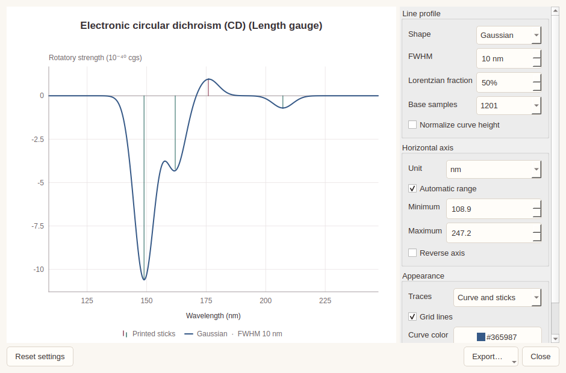

# OrcaView

OrcaView is a desktop workbench for preparing ORCA inputs and examining molecular structures, calculation logs and spectra. Its input templates target ORCA 6.1.1. Version 0.1.0a56 supports editing the ORCA input preview and syncing changes with the calculation panel. English is built in. Optional extensions provide four interface languages and three element color palettes. [Download OrcaView 0.1.0a56 alpha测试版](https://github.com/lightzfpwings/OrcaView/releases/tag/v0.1.0a56)

## Install and try OrcaView

| Platform | Package | Start |
| --- | --- | --- |
| Linux x86-64 | Portable tar.gz archive | Extract and run `./OrcaView` from the extracted folder on a graphical desktop. |
| Windows x64 | ZIP containing `OrcaView.exe`, `LICENSE` and `Examples/` | Extract into a dedicated folder and double-click the EXE. |
| macOS on Apple Silicon | DMG containing `OrcaView.app` and `Examples/` | Drag the app into Applications and copy the examples to a writable folder. |

Each download includes Python, Qt, Open Babel and 20 example files. Structures, input generation and imported results work offline. New quantum chemistry calculations require a separate ORCA installation. The local job runner uses POSIX process control. The macOS app uses an ad hoc signature. [GitHub releases and checksums](https://github.com/lightzfpwings/OrcaView/releases) · [macOS opening instructions](https://support.apple.com/en-us/102445)

Open `Examples/water.xyz` to inspect the molecule and preview an ORCA input. Open `Examples/water-sp.out` for a small teaching example of energy and charge import. The sample single-point energy is −76.123456789012 hartree. Real ORCA output files include water vibrational and NMR results and peroxide electronic transitions.

Edit **ORCA input preview**, then move the pointer outside the editor or press Tab. The calculation panel and molecular coordinates update together. The preview uses the same formatting as the exported input. An incomplete or unsupported edit stays in the editor with a diagnostic. Press Escape in the editor to restore the last applied input. The terminal equivalent is `orcaview preview molecule.xyz --edit-input edited.inp -o normalized.inp`.

### Export a structure image

Choose **File → Export structure image…**. In Design, choose the 2D sketch or 3D view. In Input and Result, the image uses the displayed 3D geometry, camera and atom labels. The preview contains the structure alone.

Choose PNG, JPEG, BMP or vector PDF. PNG and PDF offer transparent or white backgrounds. JPEG and 24-bit BMP use white.

Set the resolution multiplier from 1× to 8× (default 2×). At 4×, a 400 × 400 view is redrawn at 1600 × 1600 pixels with the same framing. Under **Advanced options**, set the final canvas dimensions. For example, 1800 × 1600 adds 100 pixels of space on either side of that 4× drawing. Smaller dimensions crop around the center. PDF retains vector detail and preserves the original print size when only the multiplier changes.

### Spectra

Open an ORCA `.log` or `.out` containing IR intensities, Raman activities, oscillator strengths or signed CD rotatory strengths. In **Results**, select a spectrum. The preview overlays the printed transitions and a Gaussian curve. **Plot settings…** opens the adjustable figure.

- Choose Gaussian, Lorentzian or pseudo-Voigt broadening, set the full width at half maximum (FWHM), and adjust the Lorentzian fraction for a mixed profile. The width uses the selected horizontal-axis unit.
- Set the x limits and direction, select the curve, sticks or both, and customize normalization, grid, line width and color. Electronic spectra support wavelength, wavenumber and energy axes.
- Export a PNG, the sampled curve as CSV, or the original transitions as CSV. NMR shieldings and coupling constants remain numerical results. Standalone vibrational frequencies show mode positions.



Try `Examples/water-raman.out` for IR and Raman or `Examples/peroxide-uv-cd.out` for UV/Vis and signed CD. The source log and printed peak data are preserved. [ORCA vibrational-spectrum documentation](https://www.faccts.de/docs/orca/6.1/manual/contents/spectroscopyproperties/vibrations.html)

### Language and element color packs

The language extension includes Simplified Chinese, Traditional Chinese, German and Japanese, together with matching Qt translations. Extract the ZIP, open **View → Interface language…**, choose the extracted **languages** folder, select a language, save and restart. The ZIP includes installation instructions and an editable template. [Language extension ZIP](https://github.com/lightzfpwings/OrcaView/releases/download/v0.1.0a56/OrcaView-Extensions-01-Language-0.1.0a56.zip)

The color extension includes Contrast, Pastel and Grayscale palettes. Extract the ZIP, open **View → Molecular appearance… → Import color pack…**, choose a JSON file from **colors** and save. The CLI can install the same file with `orcaview settings appearance --import-palette FILE`, or use it for one image with `orcaview render molecule.xyz figure.png --color-pack FILE`. [Color extension ZIP](https://github.com/lightzfpwings/OrcaView/releases/download/v0.1.0a56/OrcaView-Extensions-02-Color-0.1.0a56.zip)

Both ZIPs include their own installation guide and JSON schema. [Extension author guide](docs/extensions/README.md)

### Updating

Use **Help → Check for Updates…** to discover a release for your platform and verify its SHA-256 checksum. Save your project before choosing the option to quit and update. The installed app restarts from the same location. Windows and Linux keep a sibling `.previous` backup and preserve personal projects and edited examples. Stable versions follow stable releases. Preview versions also discover prereleases.

On Apple Silicon, versions through 0.1.0a55 recognize the new release but look for the previous DMG filename. To upgrade once, quit OrcaView, open the 0.1.0a56 DMG, and drag the app into Applications to replace the old copy. Version 0.1.0a56 recognizes both filename formats.

Windows 0.1.0a42 and earlier require a one-time manual upgrade to the single-file layout. Download and extract the Windows ZIP into a dedicated folder, then open your existing project in the new app. To retain an existing shortcut, quit the old app, rename its folder as a backup, and extract the new version at the original path.

## Structures, input and results

- Import XYZ, MOL/SDF, MOL2, PDB, CML, CDXML, SMILES, InChI and other formats through Open Babel. OrcaView can generate a starting 3D structure from a 2D file and offers a finite-cell representation for periodic inputs. It also reads coordinates from Gaussian, ORCA, Q-Chem, NWChem, Molden, FCHK, WFN and MWFN files. Binary GBW conversion requires a matching `orca_2mkl`.
- Rotate the central viewport with the left mouse button, pan with the right button and zoom with the wheel. The initial view looks down +z with x to the right and y up. Choose two atoms to measure their distance. Axis controls also support numerical rotation angles.
- Open **View → Molecular appearance…** to choose ball-and-stick, space-filling, stick or wireframe. Adjust atom size, bond thickness and the distance cutoff for inferred display bonds. The settings apply across all three workspaces and to exported structure images. [Color pack format and example](color-packs/README.md)
- Configure methods, basis sets, job types, charge and multiplicity. Adjust advanced input blocks or edit and export a native `.inp`. Inline coordinates are written to eight decimal places. [Method reference](docs/ORCA_METHODS.md)
- Read energies, orbitals, charges, dipoles, vibrations, electronic spectra and NMR properties from ORCA output. The read-only result tables support copying and retain the source filename and line. The Input workspace includes the input preview, result summary and messages.

Project settings, design, results, spectra and image export are available from the terminal. Use `orcaview render molecule.xyz molecule.png` to draw a structure offscreen. Setting `ORCAVIEW_HEADLESS=1` skips interactive display commands in unattended jobs. [Batch CLI guide](docs/CLI.md)

New jobs default to 16 ORCA processes and 4096 MB per process in both the desktop app and the CLI. Set either value independently with `--cores` or `--maxcore`. Use `orcaview resources` to see a recommendation for the current machine.

Document dialogs start on the Desktop and exports default to the opened document’s folder. The mouse wheel scrolls the calculation settings panel. Ordinary HF and DFT frequency jobs use `Freq`, including supported solvent and dispersion settings. [Calculation methods](docs/ORCA_METHODS.md)

## Molecule design

The design workspace pairs an editable 2D drawing with its 3D geometry. Drag the center divider to change their widths or double-click it to restore an equal split. A new design starts with one carbon. You can remove every atom, undo, or start again by placing an atom or a ring.

1. Choose an element by symbol or atomic number. Drag from an atom to add a bonded atom. The single, double and triple tools default to ordinary bonds. Their menus also include coordination lines and arrows, wedge bonds, aromatic partial bonds, crossed double bonds and partial triple bonds.
2. The ring tool offers three- through eight-membered carbon rings and benzene. Place a standalone ring on empty space or attach it to an atom.
3. Select a bond or Shift-select two atoms to measure a distance. On an acyclic bond, enter a target length and apply it to translate the selected side. Swap the endpoints to move the other side. Select an individual atom to edit its Cartesian coordinates.
4. Drag a selection rectangle in the drawing or Shift-drag in either view to add atoms to a selection. The two views share the selection. Atom placement, bond length changes and coordinate edits support undo and redo.
5. Click **+H**, then click atoms to add individual bonded hydrogens. Double-click **+H** to fill missing hydrogens for supported neutral singlets in one undoable operation. Manual addition is available for other charge and spin states. The design validation area reports unusual bonding.
6. The 2D cleanup action arranges the drawing's bond lengths, angles and rings. The independent 3D optimization uses Open Babel MMFF94, with UFF as a fallback. ORCA input uses the 3D coordinates. The status shows the force field used. [Open Babel force fields](https://openbabel.org/docs/Forcefields/Overview.html)
7. Return to Input to inspect or export a calculation. Each result remains associated with its calculated geometry. An individual result geometry can be sent back to Design.

The sketch highlights the target atom or bond in teal, and the 3D pane uses a blue halo. With a bond tool active, click a bond in either pane to change or remove it. To delete atoms, select them and press Delete or Backspace. A new atom placed in empty 3D space uses the depth of the last selected atom, or the centre of the molecule when the selection is empty.

## Build and test

The core and CLI support Python 3.9 and newer. Use CPython 3.13 for the portable builds. Windows packaging also requires Go 1.23 or newer. Use an arm64 virtual environment on Apple Silicon for a macOS build.

```sh
python -m pip install -e ".[gui]"
python -m orcaview gui
python -m orcaview preview examples/water.xyz --job OPT_FREQ
python tools/run_tests.py -q
python packaging/desktop/build.py both
python packaging/build_extension_kit.py
```

For macOS, install `PyInstaller==6.22.3` in the build environment and run `python packaging/macos/build.py`. Package outputs appear under `dist/<platform>/<version>/`. Once all platforms and extensions are built, run `python packaging/stage_release.py` to collect the five downloads and their `SHA256UMS.txt` manifest in release order. The test command includes both archived verification cases and tests in the checkout. [Portable build details](packaging/desktop/README.md) · [Validation history](docs/PUBLIC_VALIDATION.md)

## Licensing

OrcaView's own source uses the MIT license. Bundled libraries and ORCA output retain their respective licenses and notices. [License](LICENSE) · [Third-party software and source information](THIRD_PARTY_NOTICES.md)
