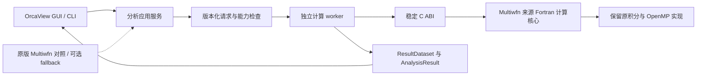

# Multiwfn 来源 Fortran 计算核心的内嵌设计

设计版本：`engine-design-1`；日期：2026-11-12。本文是正式研发方向与待实施方案，尚未建立计算库、公开 C ABI 或 worker。本轮没有编译、安装或运行 Multiwfn，也没有完成性能测试。OrcaView 当前软件 `0.1.0a1`、架构 `prototype-1` 和项目 schema 1 保持不变。

## 1. 研发方向与职责

OrcaView 的分析引擎以**自带 Multiwfn 来源的 Fortran 数值核心、稳定 C ABI、独立 worker**为主线。保留原有算法、积分实现和可用的 OpenMP 并行，通过源码拆分和接口封装移除菜单、绘图与进程控制耦合。Python 负责请求组织、数据契约和界面，不重新实现已有数值算法。

原版 Multiwfn 可执行程序保留为数值对照工具，以及用户选择的可选 fallback；它不是产品内部分析流程必须依赖的菜单自动化入口。独立 worker 是 OrcaView 自己控制的计算宿主，加载所构建的 Fortran 库并直接调用计算接口，不通过原版交互菜单执行功能。

首版仅面向**非周期分子体系**。周期波函数、晶胞和 k 点分析不在功能注册、输入接受或验收范围内。NBO/GENNBO 等依赖外部程序或外部专属产物的能力另列，不因源码含读取例程而宣称已经内嵌对应算法。



“自带”是研发和产品目标。实际纳入源码、构建和发行时，按[既有源码与使用条件研究](research/MULTIWFN_SOURCE_REVIEW.md)及第三方依赖清单执行；本文不替代该研究，也不提出新的法律结论。

## 2. 证据基线

| 项目 | 本次审查对象 |
|---|---|
| 官方源码版本 | `2026.11.12` |
| 包内根目录 | `Multiwfn_2026.11.12_src_Linux/` |
| ZIP SHA-256 | `f41897accb99d0a7bc1d156ef6a387075f6b2f21acdac0f775db3dccb8424503` |
| 本次读取方式 | 只读审查 ZIP 解压后的源码；没有编译或运行 |
| 手册基线 | `Multiwfn_manual_2026.11.3.pdf`，1168 页；与源码日期版本分别记录 |
| 来源与使用条件 | [MULTIWFN_SOURCE_REVIEW.md](research/MULTIWFN_SOURCE_REVIEW.md) |

本文以下 `文件名:行号` 均相对上述源码包根目录。升级源码后必须重新定位，不能将旧行号、菜单编号或构建结论直接套用到新版本。手册 §6.2 p1138–1140 可作为实空间求值与导数过程的导航；本文的依赖与工程判断主要来自源码，不以手册版本替代实际构建验证。完整功能与页码见[手册筛选](research/MULTIWFN_MANUAL_MAP.md)，NBO 等条件见[外部依赖清单](research/MULTIWFN_EXTERNAL_DEPENDENCIES.md)。

## 3. 可复用的计算模块簇

文件不是天然独立的计算模块。首步按公开功能建立可达过程和依赖闭包，再整理编译单元；保留计算过程，不按 Python 习惯重写公式。

| 模块簇 | 复用对象 | 源码证据与接口工作 |
|---|---|---|
| 体系与波函数数据 | 原子、primitive、轨道、占据、基组与密度矩阵 | `define.f90:1–21,262–326`；以封装层管理生命周期，不直接把原类型暴露到 C |
| 波函数读取与约定 | Molden/MWFN/WFN/WFX 读取、排序、归一化与基函数变换 | `fileIO.f90:4121–4165` 保留 Molden 壳层排序；`sub.f90:1456–1510,3711` 保留归一化与变换过程 |
| 点值和导数 | MO、密度、自旋密度、梯度、Hessian 及已选标量场 | `function.f90:422–491,2088–2108,2327–2338`；密度计算含占据及 EDF 贡献 |
| 非共价与局域场 | ELF/LOL、RDG、IRI、IGMH 等 | `function.f90:3071–3249,3931–4151,5160–5242`；按函数分别定义输入能力和参数 |
| Gaussian 型基函数解析积分 | 重叠、偶极、磁、速度、动能、多极矩与双电子积分；不依赖 Gaussian 软件 | `integral.f90:2–151,305–440,555–750,773–1080,1314–1329`；保留积分与矩阵构建实现 |
| 原子中心积分 | Lebedev 角向点、径向变换、Becke/Hirshfeld 等权重 | `sub.f90:3093–3113,3123–3152,3164–3186`；`Lebedev-Laikov.F:1–71` |
| 均匀格点评估 | 已选函数的体数据、组合场与内部 ESP | `grid.f90:9–18,145–196`；保留计算循环，单独建立非交互网格参数入口 |
| 首批数组分析 | Mayer 矩阵、Hirshfeld 电荷 | `bondorder.f90:285–346` 的 `calcMayerbndord` 已返回矩阵；`population.f90:5479–5528` 的 `genHirshfeld(charge)` 已返回电荷数组 |
| 拓扑与空间分析 | 临界点、路径、盆积分、fuzzy 原子空间 | `topology.f90:2096–2130`、`basin.f90:1927–1994`、`fuzzy.f90:22–69`；先分离菜单、配置和结果，再直接包装计算过程 |

依赖应分层保留：

- `functions` 直接依赖 `defvar` 和 `libreta`，见 `function.f90:5–8`。
- `libreta` 依赖 `ean` 与 `util`，见 `libreta_hybrid/libreta.f90:4–7`；`ean` 再依赖 `hrr`、`blockhrr`、`eanvrr`、`boysfunc`，见 `libreta_hybrid/ean.f90:1–5`。
- 线性代数保留成熟 BLAS/LAPACK 路径：`util.f90:1489–1495` 使用 `DSYEV`，`:1588–1610` 使用 `DGEMM`。
- 原子径向密度、EDF、B-spline、DFT 与分数阶功能按具体分析需要接入，不自动成为每个最小引擎构建的必选项。

例如 `function.f90` 同文件含分数阶接口（`:1601,1776`）、原子径向密度库调用（`:3843–3855`）、B-spline（`:6013`）、DFT 过程（`:6108–6350`）和周期分派（`:427–430`）。直接链接整个 `function.o` 可能带入这些依赖。实际最小闭包须经构建和符号检查确认；需要时按过程拆分编译单元，而不是假定未调用过程必然被链接器移除。

## 4. noGUI 可借鉴，但不是现成库

源码已提供 noGUI 构建，证明作者区分了图形库与无图形运行的需求；这能缩短构建研究，但不等于已存在可重入的计算库。

| 事实 | 证据 | 设计后果 |
|---|---|---|
| noGUI 仍使用含主程序、GUI、plot、PBC 的公共对象集合 | `Makefile:18–25,49–50` | 库构建必须移除主程序并重新整理计算依赖 |
| 公共模块依赖树仍连接图形相关对象 | `Makefile:75,84,90,102` | 不沿用整套对象列表作为最终最小计算库 |
| noGUI 提供大量 DISLIN 空例程 | `noGUI/dislin_d_empty.f90:4–9` | 空桩可协助过渡构建，不能代替对可达图形调用的审查 |
| 某些空例程有输出参数但不赋值 | `noGUI/dislin_d_empty.f90:12–17` | 误调用可能静默返回无效输出，不能以“没有报错”作为科学成功 |
| 空处理器默认不打印 | `noGUI/dislin_d_empty.f90:5249–5254` | 验收应主动检查调用路径，而不是只观察运行日志 |

最终内嵌核心不依赖 DISLIN 窗口，也不复用 Multiwfn 的图形事件流程；OrcaView 自己呈现分子、图表和等值面。通过现成 noGUI 构建过渡时，必须明确这仍是构建中间阶段。

## 5. I/O、STOP 与外部调用的改造

改造集中在参数入口、错误返回、状态和结果传递。原数值循环和方法实现保留，改动以独立封装及可追踪的小补丁为主。

| 耦合 | 源码证据 | 改造要求 |
|---|---|---|
| 读取错误等待输入并停止进程 | Molden 缺 `[GTO]`：`fileIO.f90:4373–4377`；i 壳层：`:4441–4446` | 返回错误码与不支持原因；`infomode=1` 不能被视为已消除这些分支 |
| 网格设置询问菜单并导入 GUI | `grid.f90:231–285` | 由 API 提供原点、轴向量、尺寸与选项，不调用交互 `setgrid` |
| 计算入口可能启动 cubegen 并删除中间文件 | `grid.f90:20–55` | 核心默认走内部算法；外部计算作为单独能力注册和执行 |
| 通用命令包装执行命令字符串，失败后 `stop` | `util.f90:2837–2860` | 不作为数值核心的公开调用能力；外部任务由参数列表进程层负责 |
| `.gbw` 读取隐含转换与删除 Molden | `fileIO.f90:100–126,391–404` | ORCA 转换作为显式任务，保留产物，再调用受控波函数读取入口 |
| 拓扑主入口混合显示、参数与菜单 | `topology.f90:2–8,35–48,57–93` | 优先直接封装 `findcp` 等计算过程，输出临界点和路径数组 |
| 盆积分入口继续询问函数与文件 | `basin.f90:1937–1968` | 把积分对象、数据来源和网格引用改为显式参数 |
| 依赖中仍有进程退出 | `ext/no2F2.c:6–10` 的 `exit(1)`；`libreta_hybrid/ryspoly.f90:1380–1382` 的 `stop` | 前置能力检查；对公开路径改造错误返回，worker 提供额外隔离 |

现有固定 Fortran 文件 unit、全局文件名及 `settings.ini` 也属于进程状态。读取、设置和产物的路径由请求显式提供；引擎不从 GUI 的当前目录隐式继承分析设置。现有 `loadsetting` 会查当前目录和 `Multiwfnpath`，见 `fileIO.f90:9739–9755`，应由库初始化配置替代。

## 6. 共享状态、生命周期与线程预算

当前源码大量使用模块共享状态，因此先采取**每个 worker 一个活动体系、同一 worker 串行请求、计算内部使用 OpenMP**。不同体系的并行通过多个 worker 实现，不声称已实现同进程多上下文。

| 状态来源 | 证据 | 必须处理的问题 |
|---|---|---|
| 体网格、文件、片段、轨道选择与初始化标志 | `define.f90:23–61` | 请求之间不能残留上次选择或网格参数 |
| MO、占据、基组与密度矩阵 | `define.f90:262–326` | 不向并发请求共享可变活动波函数 |
| 线程数、线程栈和外部程序路径 | `define.f90:485–487` | 配置必须显式，不能由另一个任务修改 |
| 拓扑状态与大型路径数组 | `define.f90:523–545` | 包括两组 `3×1500×10000` 双精度路径数组；构建及 worker 数量需要考虑静态数据规模 |
| 盆归属、吸引子和重叠矩阵 | `define.f90:591–614` | 复杂分析必须有独立清理与结果复制过程 |
| LIBRETA 积分缓存 | `libreta_hybrid/libreta.f90:16–25` | 缓存与当前波函数绑定，不能跨体系误用 |
| 解析器共享错误状态 | `fparser.f90:43–50` | 自定义表达式能力需另外评估并发与生命周期 |

`sub.f90:2861–2945` 的清理跨波函数、激发态、盆、拓扑和积分缓存标志，说明现有生命周期并非单个对象即可概括。早期导入失败后应丢弃该 worker 的未完成状态，界面保留原有效文档；不得承诺旧 native 状态在任意解析失败后仍可安全继续。

LIBRETA 源码虽有“never deallocated”注释，但后续初始化存在重新分配，见 `libreta_hybrid/libreta.f90:149–150,173–175`。本文不据注释认定内存泄漏；是否能反复载入和释放，必须通过实际内存与生命周期验收。

线程与内存预算采用以下规则：

1. 请求声明线程预算、估算内存和计算规模；调度层同时限制 worker 数与每个 worker 的 OpenMP 线程数。
2. MKL/BLAS 与 OpenMP 的线程设置一并记录，避免 worker 数、OpenMP 和线性代数嵌套叠加。原主程序在 `Multiwfn.f90:83–85` 设置 MKL 线程，库入口必须显式承接该初始化职责。
3. 保留现有高效积分与并行计算路径，评估静态/动态 OpenMP 运行时、BLAS/MKL 和编译器组合；不能默认原可执行文件的链接参数适合 Python 宿主。
4. 波函数解析、缓存创建和全局设置变化位于并行区域外。进度和错误由 worker 汇总，避免 OpenMP 线程直接回调 Python 或 Qt。
5. 大网格使用分块或受控大小的批量调用；请求取消在块边界处理，父进程终止 worker 作为失控任务的兜底，并保留已有证据。

## 7. 拟议 C ABI

以下是拟议接口，**不是现有 Multiwfn 或当前 OrcaView 可调用 API**。源码已有特殊函数的局部 `bind(C)`，见 `ext/2F2.f90:18–20`，但这不是通用分析引擎接口。

```c
uint32_t ovmw_api_version(void);

int32_t ovmw_initialize(
    const char *config_utf8, uint64_t config_length);

int32_t ovmw_load_wavefunction(
    const char *path_utf8, uint64_t path_length,
    uint32_t format_id);

int32_t ovmw_get_metadata(
    char *json_utf8, uint64_t capacity, uint64_t *required);

int32_t ovmw_eval_points(
    uint32_t function_id, uint64_t point_count,
    const double *xyz_bohr, double *values,
    uint64_t value_capacity);

int32_t ovmw_mayer_matrix(
    double *total, double *alpha, double *beta,
    uint64_t matrix_capacity);

int32_t ovmw_hirshfeld(
    double *charges, uint64_t atom_capacity);

int32_t ovmw_reset(void);

int32_t ovmw_last_error(
    char *utf8, uint64_t capacity, uint64_t *required);
```

正式头文件应显式包含标准整数类型头文件，并固定 ABI 版本、符号可见性和平台调用约定。上述配置和元数据 JSON 各有独立 schema；大规模数值不通过 JSON 文本传输。

### 数据与内存所有权

- Fortran 封装层使用 `iso_c_binding`、`c_double` 和固定宽度整数，不公开原派生类型、Fortran descriptor、`LOGICAL` 或隐藏字符串长度。
- 公共数组使用调用方提供的连续缓冲区。调用期间借用，调用结束后库不保留指针；原生计算数组和积分缓存由引擎拥有，不能由 Python 直接释放。
- 公共点坐标为 `xyz[3*i + axis]`，单位 Bohr；Fortran 可映射为 `(3, npoint)`。点值为一维数组；矩阵采用列优先，元素 `(i,j)` 位于 `i + n*j`，公共索引从 0 开始。
- Hartree、Bohr、密度及其他结果单位随元数据明确给出。OrcaView 核心的 Å 坐标在边界转换，保留原单位与转换记录。
- 元数据先查询所需长度，再复制；不足的缓冲区返回明确错误。若以后允许库分配返回内存，必须同时提供同库释放函数，不能混用分配器。
- `uint64_t` 表示公共长度，不代表原算法已支持任意大整数尺寸。封装在进入 legacy 默认整数和数组分配前检查范围、乘法溢出和内存上限。
- 首版不提供暗示多上下文的伪 handle。只有完成状态封装后，才引入真正独立的 context ABI。

### 批量调用与错误语义

- 点值、梯度和网格通过批量数组调用；不逐点跨 Python/Fortran 边界。派生数据所需输出分量、数组形状和能力版本必须明确。
- 对外功能 ID 由稳定注册表管理，不直接固定原程序的内部编号；未知 ID、缺失轨道、无占据、单位错误或不支持基函数必须在计算前拒绝。
- 状态码至少区分不支持、输入无效、数据缺失、分配失败、数值失败和取消；不依赖 stdout 文本判断数值成功。
- 所有公开可达路径不等待 stdin、不调用 `stop`/`exit`，不因设置字段隐式启动其他软件。构建静态检查与故障样例同时验证这一点。
- 部分写入的输出不能被标记为完整结果；worker 只有在数组长度、有限性和专属检查通过后才提交结果。失败的活动 native 状态可以由销毁 worker 恢复。

## 8. worker 与结果契约

worker 的职责是加载计算库、维持单体系生命周期、接收版本化请求、组织批量计算和返回结构化结果。它不是菜单脚本运行器。

拟议模块分布如下，目前尚未创建这些实现：

```text
analysis/
  capabilities.py          非周期功能与输入要求
  backends/multiwfn_core/  Python 对 C ABI 的薄封装
  workers/                 请求协议、进程、资源与取消
engine/
  upstream/                锁定版本的来源源码与说明
  patches/                 可追踪的拆分、错误及状态改造
  fortran/                 库入口与按职责整理的计算模块
  include/                 C 头文件与 ABI 契约
  build/                   编译与依赖配置
```

`WavefunctionRef` 记录文件、几何、原子映射、密度类型与能力；`AnalysisRequest` 记录功能、参数、ABI 和引擎版本；任务记录保存来源源码哈希、编译配置、数值依赖、资源和输入转换。结果继续使用 `ResultDataset` 承载数值及单位，`AnalysisResult` 承载执行和检查证据，不再建立另一套同名数值模型。

纯导入、计算和外部转换分别记录操作种类。由 ORCA 工具产生的 Molden/JSON 保留原输入、转换参数与版本；缓存键包括波函数、方法、网格、功能参数和引擎构建信息。切换配色等显示设置不触发新的数值计算；改变积分、密度或网格则产生新请求。

现有 `OutputSummary` 仍为有限文本摘要，不承载完整波函数。现有项目 schema 1 不在本轮增加分析字段；真正保存分析任务和结果时提供新的版本及迁移。

## 9. 科学语义需要保留的源码细节

| 细节 | 源码证据 | 对外行为 |
|---|---|---|
| 无 primitive 时通用密度分派可改用 promolecular density | `function.f90:17–22` | 波函数密度与原子叠加近似分别注册，缺少波函数时不得静默替代 |
| 密度包含轨道占据和可用 EDF | `function.f90:2327–2338` | 来源记录明确所用密度与核芯处理，不能只保留方法名称 |
| 核位置 ESP 使用数值处理值 `1000` | `function.f90:4259–4270` | 记录奇点/掩码及定义，不把该值无说明地当作真实有限 ESP |
| 开壳层 Mayer 例程同时给出不同定义的矩阵 | `bondorder.f90:282–284,296–319` | 总密度产生的 generalized Wiberg 与 alpha/beta Mayer 分别命名，不能都只叫“键级” |
| Hirshfeld 电荷使用内置原子密度和数值积分 | `population.f90:5488–5524` | 记录原子密度来源、积分设置和 EDF 核芯处理 |
| 求导入口部分使用数值差分 | `function.f90:2095–2108` | 元数据区分解析与数值导数，以及相应步长和参数 |
| 周期分派位于共用计算体内 | `function.f90:427–430,3873–3888` | 对外明确限制 `ifPBC == 0`；不能仅删除周期菜单就声称已排除所有入口 |

通用读取还会调用周期初始化，见 `fileIO.f90:209–213`。首版采用受控分子格式和明确的非周期检查；是否能从构建中移除全部周期符号，需按共用过程依赖审查，不能未经编译即承诺直接删除 `PBC.o`。

## 10. 分阶段交付与验收

### K0：锁定源码与计算依赖

交付来源哈希、第三方清单、补丁策略、公开功能列表和逐功能可达调用图；记录保留和排除的编译单元。当前静态研究支持开展该阶段，尚不表示阶段已全部完成。

验收：每个功能说明输入、密度、基函数、积分/网格、输出及依赖；原版程序仅作对照；周期与外部依赖功能不会混入默认可用能力。

### K1：最小 headless 库与 worker

交付独立库构建、受控波函数读取、初始化、点值/导数 ABI、单体系 worker 和错误协议。移除原版主程序，整理绘图和计算依赖；公开路径不依赖 DISLIN 空桩保证正确。

验收：闭壳层与开壳层样例的 MO、密度及导数与原程序对照；读取错误、缺失字段、取消和 worker 异常不损坏 UI 文档或原文件；公开 API 不等待输入或结束宿主。

### K2：积分、格点与首批数组分析

交付批量网格、解析积分及矩阵所需接口、Mayer、Hirshfeld 和内部 ESP。优先直接包装已有数组过程；保留 LIBRETA、BLAS/LAPACK 和适用的 OpenMP 实现。

验收：矩阵定义、自旋、单位、积分误差和 ECP/EDF 行为分别核对；网格原点、轴和数据顺序一致；重复任务不会串用缓存；大数组容量与资源检查有效。

### K3：拓扑、空间与高级基态分析

逐项分离 fuzzy、临界点/路径、盆积分等高层过程的参数、状态和 I/O。新增显式配置、结果数组和数值检查，不重新实现其算法。

验收：每种分析有代表性真实样例、积分或拓扑收敛证据、错误路径和可导出数据；复杂分析的清理、取消及重新载入经过检查。

### K4：高级功能与上下文演进

在输入链路验证后扩展激发态等功能，并逐步将共享状态迁入真正 context。NBO/GENNBO 等外部数据链继续单列；是否支持同进程多上下文以实际状态改造和并发验证为准。

验收：高级功能的轨道、态、振幅或密度语义完整；每个新增能力有真实对照。只有完成状态隔离后才开放多 context；worker 可以继续作为长期稳定的资源和故障边界。

## 11. 数据正确性与性能验证

正确性和性能各自验收。保留原 Fortran 实现是性能设计依据，不是“已经测得与原版等速”的证据。

| 维度 | 要记录和比较的内容 |
|---|---|
| 数值对照 | 相同输入、原子顺序、自旋、密度定义、积分网格和阈值；与原版 Multiwfn 比较原始数组，容差按物理量制定 |
| 科学边界 | 闭壳层、开壳层、不同基函数约定；宣布支持 ECP/EDF 前加入相应样例；不支持项明确拒绝 |
| 生命周期 | 反复载入、计算、失败、取消与销毁；内存峰值、缓存失效及活动进程数量 |
| 批量边界 | 单点与批量一致；不同块大小一致；数组顺序、矩阵含义、零长度和超限请求 |
| 性能对照 | 同机、同编译配置、同数值库、同线程和输入；分别测加载/初始化、计算、复制与 worker 通信 |
| 并行行为 | 1 线程与多线程误差、速度变化、峰值内存、多个 worker 的总资源；不以多线程位级相同作为未经分析的统一要求 |
| 故障恢复 | 截断文件、异常数据、分配失败、原生异常、超时及取消；失败不提交完整结果 |

内嵌方案需要实测定位开销：若计算已经占主导，不为减少少量通信而强行放弃隔离；若数组复制成为实际瓶颈，再评估共享内存或受控零复制。任何零复制接口必须先解决内存所有权、生命周期、数据修改和 worker 异常后的失效问题。

本轮没有上述测量，因此没有吞吐量、加速比、内存节省、编译器兼容或跨平台性能结论。后续报告保留输入、输出、构建与资源记录，区分替身协议测试、原程序数值对照和真实 ORCA 文件验证。

## 12. 外部与第三方依赖边界

下表是工程依赖清单，不产生新的许可解释。Multiwfn 本身的条款和引用要求见[既有研究](research/MULTIWFN_SOURCE_REVIEW.md)；各依赖的具体使用、修改和发行条件在选定构建后分别核对。

| 依赖类别 | 源码证据 | 工程安排 |
|---|---|---|
| NBO/GENNBO 产物 | `NAONBO.f90:3–20` 读取 NAO/密度/变换；`fileIO.f90:8412,8491–8493` 导出 `.47` | 外部专属分析链单列，不宣称含 NBO 算法实现 |
| Gaussian/ORCA 计算 | `sub.f90:4291–4320` | 不由数值库隐式启动；需要时通过独立外部任务适配 |
| ORCA 转换工具 | `fileIO.f90:391–404` | 显式参数列表转换，保留版本和产物，随后载入分子波函数 |
| Gaussian cubegen/formchk | `grid.f90:20–55`；`fileIO.f90:61–98` | 不作为内嵌数值核心的默认必需依赖 |
| DFT-D3 | `EDA.f90:968–1033` | 与内部电子结构分析分开登记外部能力及临时文件策略 |
| FLINT/Arb | `Makefile:27–36`；`ext/2F2.c:1–8` | 仅相关功能构建选择启用；缺失时明确禁用，不进入 `exit(1)` 路径 |
| 编译器、OpenMP、MKL/BLAS/LAPACK | `Makefile:3–4,12`；`util.f90:1489–1495,1588–1610` | 锁定实际工具链和运行时；共享库构建另行确认位置无关代码、符号与分发依赖 |
| 图形栈 | `Makefile:9,18–25` | 最终计算核心移除 DISLIN/X11/Motif/OpenGL 依赖 |
| SYVA、B-spline、DFTxclib 等 | `sym.F:4–20`；`Bspline.f90:1–3`；`DFTxclib.F:57–62` | 保留来源与标注；在外层封装，按对应原文处理修改和发行事项 |

原编译说明 `COMPILATION_METHOD.txt:1–2` 针对 ifort，并不保证 gfortran 构建成功；源码 Makefile 也不是现成跨平台共享库配置。Linux 为优先构建目标，其他平台、编译器和数值库组合分别验证，不提前列为已支持。

这条研发路线的首个可审阅交付应是：锁定来源和补丁的最小 Fortran 库、清楚的 C 头文件、单体系 worker、点值/矩阵真实对照及资源记录。只有该闭环通过后，再逐项开放更多分析能力。
