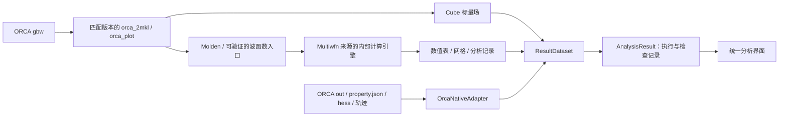

# OrcaView 后处理与 Multiwfn 集成设计

设计修订：`analysis-design-2`，2026-11-12。软件仍为 `0.1.0a1`，架构 `prototype-1`，现有项目 schema 1 不变。本文是待实施设计，不代表当前原型已经包含分析引擎或外部程序调用。

## 1. 产品定位与结论

将 OrcaView 建设为同时包含**建模准备、计算管理、结果分析**的工作台。分析是独立主线：用户可以导入已有 ORCA 文件并完成分析，不要求先通过 OrcaView 运行 ORCA，也不要求先实现分子编辑器。

分析主线改为**复用 Multiwfn 的 Fortran 数值核心，构建可随 OrcaView 提供的内部分析引擎**。保留成熟的波函数求值、导数、Gaussian 型基函数解析积分、原子中心数值积分和各分析过程；新增结构化接口、生命周期与结果封装，不重写复杂科学算法。初版把计算库加载在自有 worker 中，一个进程一个活动体系，保护桌面界面并保留 OpenMP。原版 Multiwfn 命令行用于数值对照和可选兼容模式，菜单脚本不再作为正式核心接口。

依据为完整的官方 `2026.11.3` 手册（1168 个 PDF 物理页）、官方 `2026.11.12` 源码与 ORCA 6.1 文档。[手册功能筛选](research/MULTIWFN_MANUAL_MAP.md)列出保留的分子分析、章节与页码；[外部依赖清单](research/MULTIWFN_EXTERNAL_DEPENDENCIES.md)单列 NBO、Gaussian 专门数据及额外程序；[内嵌引擎设计](MULTIWFN_ENGINE_DESIGN.md)给出计算簇、C ABI、线程/内存和 K0–K4 阶段。周期体系不进入范围。

源码来源与使用条件见 [MULTIWFN_SOURCE_REVIEW.md](research/MULTIWFN_SOURCE_REVIEW.md)，文件与方法兼容性见 [MULTIWFN_ORCA_COMPATIBILITY.md](research/MULTIWFN_ORCA_COMPATIBILITY.md)。当前没有把第三方算法加入产品、编译引擎或运行数值验证。

## 2. 两种分析来源

### ORCA 原生结果适配

从 `.out`、结构化性质、`.hess`、结构轨迹及官方转换工具读取实际产生的数据。优先支持优化曲线、收敛表、振动、IR、已有电荷与键级、轨道能级和已有激发态结果。来源中未输出的数据保留缺失，不按界面需求自行补造。

例如，展示 ORCA 已打印的 Mulliken 电荷，与用 Multiwfn 重新执行某种电荷分区，是两个分析来源；必须分别标明方法、密度和来源，不能合并为一个含糊的“原子电荷”。

### Multiwfn 波函数分析适配

输入信息充分且相应能力已经验证时，通过内部引擎的批量数值接口产生原子表、矩阵、曲线、网格、轨道或拓扑记录。OrcaView 管理请求、来源和渲染；Fortran 计算体承担数值工作。已有 PNG 可作为附件，不能代替结构化结果。可选外部原版后端也输出同一数据契约，但来源中明确标识不同构建与调用路径。

## 3. 功能与输入矩阵

下表是推荐的实现顺序。输入列表示集成时必须核对的条件，并不承诺每种 ORCA 方法、每个版本都兼容。

| 分析模块 | 推荐来源 | 所需数据/检查 | 优先级 |
|---|---|---|---|
| 优化轨迹、能量与收敛曲线 | ORCA 原生结果 | 完整输出或结构化性质、每步几何和单位 | A1 |
| 振动动画与 IR | ORCA 原生结果 | 频率、真实模态位移、强度、对应几何；优先核对 `.hess` | A1 |
| 已有原子电荷、Mayer 等键级 | ORCA 原生结果 | 已输出的具体定义与原子索引 | A1 |
| MO 能级、占据、轨道表面 | ORCA 工具 + 可选 Multiwfn | 波函数、轨道与自旋信息；Cube 需几何/网格一致 | A1–A2 |
| 电荷分区与额外键级分析 | Multiwfn | 适用的基组、轨道、占据、电子密度；按分析方法声明条件 | A2 |
| 电子密度与静电势映射 | Multiwfn / ORCA 网格 | 波函数或已计算标量场、有效核电荷、网格和单位 | A2 |
| RDG/NCI、IRI、IGMH | Multiwfn | 波函数及相应定义所需信息；显示阈值与网格参数可追溯 | A2 |
| ELF、LOL 与 QTAIM/盆分析 | Multiwfn | 轨道/密度及导数；拓扑搜索与积分收敛单独验证 | A3 |
| Fukui、双描述符及相关差分 | Multiwfn | 依配方核对 N、N+1、N−1 等状态、相同几何/方法及原子映射 | A3 |
| 空穴—电子、跃迁密度、NTO | 优先 ORCA 原生可用数据，后接 Multiwfn | 波函数及足够的激发态信息；逐方法验证 TDA 与完整 TDDFT；SF-TDDFT 不支持依赖 TDM 的分析（含 NTO） | A4 |
| UV–Vis 等谱图 | 原始跃迁数据 + 本地绘图 | 能量、强度、单位、展宽类型/宽度；高级跃迁分析另行要求数据 | A1/A4 |

本表是起步顺序，不是完整功能范围。分子 DOS/PES、轨道局域化、模糊原子空间、通用积分与矩、CDA/NOCV、EDA-FF、NLO、芳香性、波函数变换等均纳入[全功能目录](research/MULTIWFN_MANUAL_MAP.md)。AdNDP/NAO 虽有 Multiwfn 计算代码，仍需要 NBO/GENNBO 矩阵，放入独立条件依赖区。

RDG/IRI/IGMH、不同电荷与键级定义分别注册。几何叠加的近似场与真实波函数结果分别命名。排除周期波函数、PBC、晶胞/超胞、周期网格复制、晶胞自由体积和周期专用计算流程；保留同一算法的分子分支，不将分子 DOS 或拓扑整体删除。

Raman 必须具备实际 Raman 活性等所需数据；普通频率文件中只有频率和 IR 强度时不显示伪造的 Raman 谱。XYZ 只表示几何，单独一个 XYZ 不足以承诺真实波函数分析。 本版手册未支持 ORCA→Multiwfn 的 ROA 通路；保留 ROA 时需单独验证数据来源。NOCV 限受限闭壳层或非受限开壳层 HF/KS，且能量估计不等同严格完整 ETS-NOCV。EDA-FF 可内置其力场分解，SBL、sobEDA 和修改版 D3 的条件另列。

## 4. ORCA 文件通道



常见波函数路线为：

```text
job.gbw
  → 同版本 ORCA 的 orca_2mkl job -molden
  → job.molden.input
  → 经兼容检查的内部引擎请求
  → 数值表 / Cube / 其他数据产物
  → OrcaView 数据适配和可视化
```

Multiwfn 支持借助配置好的 ORCA 转换器直接载入 `.gbw`。本次源码的这条路径含系统命令字符串调用和转换后删除 Molden 的行为；OrcaView 集成优先自己通过参数列表显式转换，在独立任务目录保留 Molden，然后再调用分析后端。不能把直接打开 `.gbw` 理解为可任意解析所有版本的二进制。

`property.json` 提供的性质、波函数导出的轨道与基组、Cube 标量场分别按自己的能力处理。只存在一个密度 Cube 时，不能自动启用所有需要轨道、占据、基组或高阶导数的功能。

转成 `.mwfn` 可以作为经过验证的内部缓存选项；不得把它当作当前已经实现的通用转换承诺。缓存必须保留原始文件哈希、转换过程、有效核电荷和源几何。

## 5. 数据质量与方法边界

在分析开始前，对所需信息逐项检查并在界面呈现原因：

- 元素、原子顺序、坐标单位和几何一致性；不同输入之间使用显式原子映射。
- alpha/beta 轨道、占据和自旋；不能把开壳层波函数按闭壳层重复占据。
- Cartesian/spherical 基函数、函数排序和归一化约定；完成一组代表性文件的数值核对后再宣布支持。
- ECP 的有效核电荷与电子数；来源未知时禁止按全电子体系推断静电势、分区电荷等关键量。
- SCF 轨道密度、相关方法的总密度、弛豫/未弛豫密度与跃迁密度分别标识；不能只因计算方法标签是相关方法就把某份 MO 密度当作相应相关密度。
- 多状态/差分分析核对电子态、计算设置、几何及来源，不从单一基态文件编造缺少的态。
- Cube 原点、网格轴、标量顺序、单位和分子坐标必须统一；差分前先检验网格兼容性。

激发态尤其需要逐配方验证：显示激发能和振子强度所需的数据少于重建跃迁密度或进行空穴—电子分析所需的数据。TDA 与完整 TDDFT 的振幅语义不同；不能把输出中的组态贡献平方根无条件当作可靠的带符号 X/Y 振幅。 对 ORCA SF-TDDFT，本版手册只明确支持部分空穴—电子及激发态自然轨道分析，所有依赖跃迁密度矩阵（TDM）的功能，包括 NTO，均不开放；不能从普通 TDDFT 支持直接外推。

本次官方 `2026.11.12` 源码已有更完整的 ORCA JSON 路径：`excittrans.f90` 在常规 ORCA 输出入口寻找同名 `.json`，在 `wfntype == 0` 的闭壳层参考态路径读取振幅，对完整 TDDFT 使用 X+Y 与 X−Y 重建 X、Y；其他参考态会退回输出文本路径。应把“有正确振幅的闭壳层 JSON 配方”与“仅输出文本的近似/受限配方”分开注册。前者不是所有开壳层或多参考态的通用支持声明，且本次未运行验证。

该 `.json` 是由 ORCA 转换工具提供的激发态数据入口，不能拿 `.property.json` 代替。当前作者在线手册与 ORCA 6.1 文档给出的准备方式，是创建 `TDDFT.json.conf`，内容为 `{"CIS": true, "CISNRoots": true}`，再运行同套 ORCA 的 `orca_2json TDDFT.gbw`，保留同次计算的参考态 Molden、`.out` 和生成的 `.json`。该文档路径没有要求单独 `.cis` 文件；其他版本/方法不得直接外推。

后端仍须核对轨道窗口及相应振幅字段、与源波函数的轨道索引一致，并完成真实转换与数值核验。准确步骤与回退限制见 [兼容性核查](research/MULTIWFN_ORCA_COMPATIBILITY.md)。初期优先显示 ORCA 原生可获得的 NTO 和光谱；在真实样例核验后再开放高级分析。

## 6. 模块与契约设计

以下目录是计划新增模块，目前尚未创建为已实现 API：

```text
analysis/
  contracts.py           分析输入、请求、结果和来源契约
  capabilities.py        功能注册、输入要求和兼容性检查
  service.py             组织分析用例，不依赖 Qt
  backends/
    orca_native.py       ORCA 原生结果读取
    multiwfn_core/       内置计算库的能力、ABI 与结果适配
    multiwfn_external/   原版对照及可选菜单配方后端
  tasks/                 独立工作目录、取消、日志与结果检查
io/
  molden.py              后续按能力范围实现，不承诺完整无损解析
  cube.py                网格、单位和标量适配
rendering/               表格、曲线、振动与三维场显示适配
engine/                 固定上游计算过程、改造记录、构建与 C ABI 封装
analysis/workers/       自有后台宿主、结构化协议与资源隔离
```

| 计划契约 | 关键字段/规则 |
|---|---|
| `WavefunctionRef` | 源文件与哈希、ORCA 版本、几何修订、原子映射、单位、已知轨道/占据/自旋/ECP/密度能力；未知显式保留 |
| `AnalysisRequest` | 功能 ID、功能/契约版本、后端配置、输入引用、分析参数、网格和积分设置；不接受任意 shell 字符串 |
| `AnalysisTaskRecord` | 操作种类、核心构建/源码哈希、ABI/算法版本、设置、线程与数值阈值、转换参数、工作目录、时间、状态、日志和产物；外部后端另记配方及实际 stdin，纯文件导入无进程字段 |
| `ResultDataset` | 版本化类型、数值及单位、原子/几何/网格引用和来源；ORCA 原生结果与 Multiwfn 产物共用此数据载荷 |
| `AnalysisResult` | 请求与任务引用、一个或多个 `ResultDataset`、后端/配方来源、检查证据、缺失项及状态；作为分析执行结果的封套 |
| `AnalysisCapability` | 所需输入与支持范围、后端版本范围、输出种类、已验证样例；输入不足时给出具体原因 |

`ResultDataset` 支持原子标量、原子对矩阵、轨道表、曲线、振动模态、标量网格、临界点/路径等多种类型，避免所有功能都输出一个无法追溯的图片路径。每种类型都应有独立版本和验证方法。`AnalysisResult` 承载一次操作的执行与检查记录，不另建一套数值数据模型；原生导入也生成同类载荷。

现有 `OutputSummary` 继续作为有限文本摘要，不强行扩展为承载全部波函数数据的对象。现有 schema 1 不新增字段；真正加入分析持久化时显式升级并提供迁移。

## 7. 内置引擎与可选外部后端

正式主线为 `OrcaView → 自有 worker → C ABI → Multiwfn 来源 Fortran 计算簇`。这不是现成上游库 API，而是需要维护的派生计算构建；数据与算法复用，菜单、绘图、终止进程和隐式外部命令须分离。初版不承诺同进程多波函数可重入，按 worker 隔离体系；库只接收受控分子输入和显式配置，不读取桌面工作目录中的可变设置。

优先包装批量点值/导数、网格、内部 ESP，以及已有数组返回的 `calcMayerbndord`、`genHirshfeld`。保留 Gaussian 型基函数解析积分、Becke/Lebedev 等数值积分和 OpenMP；这些积分实现不依赖 Gaussian 软件。Python 不逐点循环计算波函数。较重的拓扑、盆积分、fuzzy 空间、高级态分析逐项分离交互。ABI 的缓冲区、单位、数组布局、错误码与清理必须明确。详情与源码行号见 [引擎设计](MULTIWFN_ENGINE_DESIGN.md)。

原版 `noGUI` 仍含主程序、菜单和 DISLIN 空桩，成功链接不证明已经获得纯计算库。原版命令行只作为数值参考与可选兼容后端；选用它时遵循以下流程：

1. 探测用户配置的 Multiwfn 与 ORCA 转换工具，记录具体版本/构建；版本未知或配方未验证时，不提供默认的一键自动化。
2. 根据输入能力决定功能可用性；缺少数据时列出缺失文件或计算选项。
3. 为每次分析建立独立目录；保留原始波函数，以工作副本或只读引用作为输入。
4. 为该目录生成专属设置与 stdin 配方，防止并行任务共用可变设置或固定命名输出相互覆盖。
5. 用参数列表和 stdin 文件/流启动进程，不依赖 shell 重定向、不使用 `shell=True`。后台执行、取消和进程组清理与 GUI 解耦。
6. 分别检查进程状态、版本/菜单交互证据和预期产物；退出码为 0 不足以判定分析成功。
7. 校验数值、单位、数组长度、几何与网格引用，生成统一 `ResultDataset`，并放入带检查记录的 `AnalysisResult`。失败保留输入、设置、日志与产物。

菜单脚本按 `backend build + recipe ID + recipe version` 管理。不能把某个日期版本的菜单编号当作永久 API。含交互窗口的任务改用经过验证的文件导出路径或可用的无图形构建；GUI 不自动控制另一个程序的窗口。

软件分发按可复现的内部引擎构建规划；原版外部程序保留为可选配置。官方条款允许免费学术/商业使用及作为商业软件的免费组件分发，售卖修改版须事先取得作者同意，并要求引用两篇原始论文。内部派生构建保留来源、改造记录和引用，逐项记录数值库、参考密度数据与运行时的使用条件；不自行假定标准许可证。NBO 等额外软件不随基础引擎捆绑。

## 8. 分析工作区

在主窗口加入独立“分析”入口，围绕当前选中的**结果几何和数据来源**组织：

- 左侧：原始计算、几何帧、波函数、已导入结果与分析记录。
- 中央：分子、振动或等值面；能量/谱图可以与分子并列。
- 右侧：当前分析方法、所需数据检查、参数、数值单位和来源。
- 底部：原始数值表、日志、证据和可导出结果。

点击原子电荷表选中原子，点击轨道行切换轨道表面，点击频率行播放真实位移，点击优化曲线切换几何帧。显示配色/等值面阈值只改变显示层；若参数会改变数值计算，应生成新的分析请求。

用户必须能看见“谁计算了这个量、用了哪个密度/几何、是否经过转换、显示单位是什么”。基础资料缺失时明确显示待补数据，保留已有可查看内容。

依据 [GaussView 6 对照与交互规格](GAUSSVIEW6_ALIGNMENT.md)，分析工作区补充以下正式要求（待实施）：

- **来源与导航**：一次导入可检查关联 out/hess/gbw/JSON 等数据；结果绑定不可变 `GeometryRef`，文件同名不能代替关联证据。曲线点、实际帧与数值表共享导航。
- **振动闭环**：模态、频率表与谱共享稳定身份；虚频正负位移显式创建新候选结构，并可派生计算。动画和对齐不改写科学几何。
- **轨道与图层**：用波函数/轨道表示/自旋/原始编号定位；网格、建面场、映射场与显示层分别引用。比较可锁定等值面阈值和色标。
- **谱与比较**：多谱叠加、实验数据、手动混合权重；Boltzmann 加权要求可比较构象、明确能量类型/温度/简并度。NMR 按屏蔽、参考与耦合数据分别开放。
- **任务派生**：从明确结果帧创建新任务，记录父来源与实际复制设置；波函数重用另做兼容检查，不覆盖旧任务。

这些交互由 OrcaView 的选择、编辑、结果导航和渲染模块实现。内部 Multiwfn 核心负责数值工作，不承担桌面选择状态或视图管理。

## 9. 实施顺序与验收

分析主线与建模主线并行推进：

- **A1 原生结果与数据底座**：结果来源契约、优化曲线、真实振动/IR、轨道与已有性质表；同时实现 Cube 读取和基本显示。
- **A2 首个内置 Multiwfn 核心闭环**：先完成 K0 来源/依赖与 K1 分子加载、点值和 C ABI，再完成 K2 批量网格、Mayer/Hirshfeld 与内部 ESP。真实 ORCA→Molden 数据与同版本原版对照；通过后加入 RDG/IRI。
- **A3 深入基态分析**：更多分区/键级、ELF/LOL、拓扑/盆积分和多状态反应性；按方法逐项建立误差与完整性检查。
- **A4 激发态与高级联动**：原生 NTO/光谱优先；充分验证跃迁信息后逐步接入空穴—电子等分析。

首个后端闭环应满足：

1. 对来源与使用条件明确的真实 ORCA 样例，以相同输入、阈值和线程预算比较内部计算核心与锁定版本原版；容差按物理量分别说明。原程序只是数值回归参照，另需电子数、归一化、网格和积分等独立检查。
2. 覆盖闭壳层、开壳层，并在宣布 ECP 支持前覆盖含 ECP 样例；不支持的情况给出具体原因。
3. 版本不匹配、交互菜单变化、缺失文件、转换失败、取消、并行固定文件名冲突均不产生假成功。
4. 所有数值能追溯至文件、几何、工具、配方与参数；图表和网格导出保留单位。
5. 启用分析模块不改变已有 XYZ、输入生成和 schema 1 项目行为。

当前尚未运行这些真实样例，不能把设计评估视为后端集成验证完成。

性能验收比较启动/加载、计算、数据传输、总耗时与峰值内存，区分冷启动和同一体系连续分析。保留原算法和并行实现是设计目标；内嵌本身不保证数值计算自动加速，不能用架构推断替代测量。

## 10. 参考资料

- Multiwfn 作者官方站点与下载：<http://sobereva.com/multiwfn/>、<http://sobereva.com/multiwfn/download.html>。
- 作者快速入门（本次可读取的 2026-01-07 文档）：<https://sobereva.com/multiwfn/misc/Multiwfn%20quick%20start.pdf>，输入文件、非交互运行与进阶功能入口。
- 官方源码包、具体模块与许可核查见 [源码调研记录](research/MULTIWFN_SOURCE_REVIEW.md)；日期版本不自动等于配方已经通过验证。
- ORCA 6.1 官方 Utilities and Visualization：<https://www.faccts.de/docs/orca/6.1/manual/contents/utilitiesvisualization/utilities.html>，`orca_2mkl`、`orca_plot` 和输出文件通道。
- ORCA 6.1 Property File：<https://www.faccts.de/docs/orca/6.1/manual/contents/utilitiesvisualization/property_file.html>。

