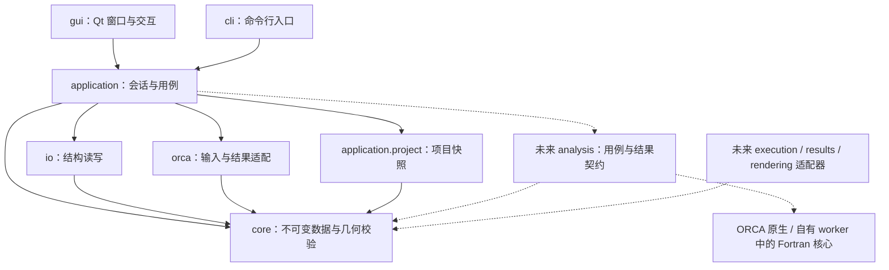
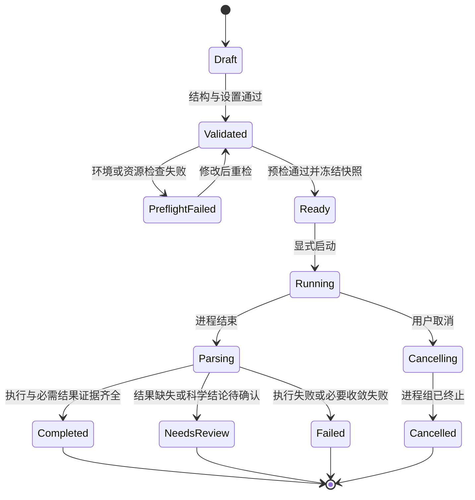

# OrcaView 设计框架

设计日期：2026-11-12；实现状态更新：2026-11-19。软件版本：`0.1.0a1`；架构版本：`prototype-1`；项目文件版本：schema 1/2。交互设计修订：`interaction-design-1`（编辑与完整结果交互待实施）。

本文将**官方产品事实**、**OrcaView 的设计选择**、**当前原型能力**与**未来计划**分别标明。当前原型用于验证架构与交互，不代表已经获得与 GaussView 6 同等的化学建模和结果分析能力。

## 1. 产品目标与边界

OrcaView 是面向 ORCA 的本地桌面可视化辅助软件。目标是把“建立分子 → 检查结构 → 配置计算 → 审阅输入 → 运行与监测 → 分析结果”组织为可理解、可追溯的工作流。

后处理是与建模准备并列的产品主线。已有 ORCA 计算可以直接导入分析，无需先通过 OrcaView 执行。ORCA 原生结果适配与内部 Multiwfn 来源数值引擎共用带来源、单位和几何引用的结果模型。分析方案 `analysis-design-2` 复用 Fortran 求值、积分和分析过程，经新增 C ABI 加载到自有 worker；原版命令行用于数值对照和可选兼容。周期分支排除，NBO 等额外程序/数据单列。见 [后处理设计](POSTPROCESSING.md)、[完整手册筛选](research/MULTIWFN_MANUAL_MAP.md)与[内嵌引擎设计](MULTIWFN_ENGINE_DESIGN.md)。这些扩展尚未实现。

以 Linux 为首发运行平台规划；当前开发环境也覆盖 macOS。使用 Python 3.9+，桌面原型采用 PySide6 6.8.3；核心数据与文件处理不依赖 Qt。ORCA 不随应用分发，用户独立安装。当前输入生成以 **ORCA 6.1 的基础语法子集**为目标，不宣称全版本、全方法兼容。

优先服务三类场景：学生完成小分子的常规计算准备；研究人员检查输入、几何和结果证据；熟练用户在可视化检查与原生 ORCA 文件之间往返。第一阶段以单分子、单作业、本地文件为范围，调度器、远程集群、多用户协作与自动决策不进入当前范围。

## 2. 参考 GaussView 6 的哪些设计

**官方事实。** GaussView 6 将构建、计算设置和结果查看组织在 Builder、Calculate、Results 等功能入口中。其控制面板含菜单、工具栏与当前构建片段，分子拥有独立视图；分子、分子组与视图区分管理。计算设置按任务、方法、资源等分组，提供输入预览；结果包括振动、谱图、轨道与表面等显示。[G1，第 1–9、12–33、43–61、75–145、173–176 页]

**OrcaView 的设计选择。** 借鉴工作流和科学对象之间的关系，使用适合 ORCA 的输入、文件和结果模型；界面自行设计，不复制 GaussView 的图标、专有素材或窗口外观。

| 借鉴的交互原则 | OrcaView 的设计 | 当前状态 |
|---|---|---|
| 结构是配置与结果的共同上下文 | 中央分子视图，所有面板围绕当前文档工作 | 单文档原型 |
| 参数与生成输入可同时检查 | 右侧结构化设置，底部原生输入预览 | 已实现基础子集 |
| 构建工具随操作目标变化 | 元素、片段、键、测量、约束工具分别进入上下文工具栏 | 编辑工具待实现 |
| 列表、图表与分子联动 | 原子选择先落到共享状态，后续连接振动、轨道和扫描结果 | 已有原子选择与测距；结果联动待实现 |
| 分子与视图区分 | 科学坐标固定保留，旋转、缩放、选择属于视图状态 | 当前原型遵循此边界 |
| 运行与结果可追踪 | 原始输入、日志、计算设置、软件版本与结果证据关联 | 任务记录与执行待实现 |

本次对照将易用性要求纳入正式框架，详细区分“当前已有”“已有规划”和“新增/细化”，见 [GaussView 6 功能对照与交互设计](GAUSSVIEW6_ALIGNMENT.md)。优先落实以下操作闭环：

| 操作闭环 | 设计要求 | 交付阶段 |
|---|---|---|
| 点选 → 精确编辑 | 有序选择 2/3/4 原子，输入距离/角度/二面角，指定固定端和移动集合；预览、确认、取消和撤销 | P1 |
| 坐标 → 约束/扫描 | 相同坐标对象可测量、冻结或扫描；先一维，逐点保留几何与收敛状态 | P2 / A1 扩展 |
| 频率 → 动画 → 新结构 | 频率/谱/模态联动；正负位移显式生成候选结构与派生任务 | A1 / P2–P3 |
| 能级 → 轨道 → 表面 | 原始轨道身份与自旋保持稳定，网格、建面场、映射场和显示层分离 | A1 / P5 / A2 |
| 多谱 → 比较/混合 | 明确展宽、单位与权重；Boltzmann 权重有能量、温度、构象集合与来源条件 | A1 / A4 扩展 |
| 结果帧 → 比较/新任务 | 使用明确的实际帧与原子映射；对齐只改变显示，新任务保留父结果来源 | P1 契约 / A1 / P3 |

这些要求不改变周期体系排除和 NBO 等外部依赖的边界。多模型与多视图的对象关系在 P1 建立，结果比较按 A1/P5 交付，不再全部推迟到发布完善阶段。

## 3. 用户主流程

### 当前可走通的准备流程

1. 打开单帧 XYZ，或使用示例结构。
2. 旋转、缩放、选择原子，检查两原子距离；距离单位为 Å。
3. 明确总电荷与自旋多重度，选择方法、基组、SP/OPT/FREQ/OPT_FREQ、核数和每核内存。
4. 查看参数校验与生成输入；导出 `.inp`。
5. 将当前结构与设置保存为 `.oview.json`；后续重新打开继续工作。
6. 使用现有 `.out` 文件读取文本摘要，检查正常结束、SCF 与几何收敛证据。

此流程中的输出文件由用户提供，当前应用没有执行 ORCA。GUI 和 CLI 共用核心校验、输入生成及输出摘要逻辑。

当前原型已跟踪未保存的设置变更，并在关闭或替换文档前处理保存选择。后续分子编辑将接入同一文档状态，并扩展修订和历史。

### 目标完整流程

未来在准备流程中补充分子编辑、撤销、几何约束与版本化结构；再加入本地运行。运行前冻结一次输入快照并执行环境预检。运行过程中只追加日志与进度证据，运行结束后分别判断程序结束、方法收敛和科学目标是否满足；结果视图保留来源文件、结构帧和单位。用户对结果的选择可以创建新计算，不能覆盖旧计算的输入与记录。

## 4. 桌面信息架构

**设计选择：** 使用单主窗口与可停靠面板，避免频繁寻找多个独立窗口；后续允许同一文档建立多个视图。

```text
┌─────────────────────────────────────────────────────────────────────┐
│ 文件  编辑  构建  计算  结果  视图  帮助      当前文档 / 保存状态      │
├──────────────┬─────────────────────────────────┬─────────────────────┤
│ 项目与结构树 │                                 │ 当前上下文设置      │
│ · 当前分子   │        中央分子视图              │ · 电荷 / 多重度     │
│ · 原子列表   │                                 │ · 方法 / 基组       │
│ · 计算设置   │   旋转 · 缩放 · 选择 · 测距     │ · 任务 / 计算资源   │
│ · 作业*      │                                 │ · 校验结果          │
│ · 结果*      │                                 │                     │
├──────────────┴─────────────────────────────────┴─────────────────────┤
│ 原生输入预览  |  日志  |  输出摘要  |  图表*                         │
├─────────────────────────────────────────────────────────────────────┤
│ 当前模式 · 选中原子 · 坐标与能量单位 · 警告 / 作业状态               │
└─────────────────────────────────────────────────────────────────────┘
* 作业管理与科学图表属于后续阶段。
```

中央视图当前以 CPU 投影绘制球棍，用于验证交互与模块边界；它不是完整的化学建模引擎。支持识别全部 118 个元素符号；显示半径对常用元素提供参数，其余采用回退值。原子半径、颜色和距离阈值只辅助显示；由距离推断的连线仅为启发式单键，不用于推断芳香性、键级、价态或合理电子态。

正式渲染层应通过适配器接入成熟三维引擎。大体积 Cube、轨道、等值面与拾取需求优先评估可选 VTK 后端；科学数据对象不能依赖 VTK 或 Qt 类。原型保留 CPU 后端，以便无图形环境验证核心模块。

## 5. 功能范围对照

| 能力 | 当前 0.1.0a1 原型 | 后续目标与边界 |
|---|---|---|
| 结构导入 | 单帧 XYZ；全部 118 个元素符号；非法坐标检查 | 多帧 XYZ、SDF/MOL 与 ORCA 几何适配；格式与能力分别声明 |
| 化学键 | 距离阈值推断单键、保存已有键记录 | 人工键编辑与可选化学感知；必须记录推断来源 |
| 结构编辑 | 尚未实现 | 添加/删除/替换原子、键与片段、受控补氢、数值几何修改的移动集合/预览/取消、撤销/重做 |
| 视图与测量 | 球棍、旋转、缩放、原子选择、两原子测距 | 有序选择、保存选择集、角度/二面角、框选/片段选择、多模型/多视图与比较 |
| 电子态检查 | 总电荷、多重度、电子数相容性校验 | 保留人工确认；基础检查不证明化学态正确 |
| 输入生成 | 方法白名单 HF/B3LYP/PBE0/PBE；基组白名单 def2-SVP/def2-TZVP/def2-TZVPP；四类任务；`%pal`、`%maxcore`、内嵌 XYZ | SCF、网格、溶剂、约束、分区/原子基组与方法能力声明 |
| 输入编辑 | 只读生成预览与导出 | 高级原文编辑及冲突提示；完整 ORCA 语法不做无损可视化承诺 |
| 项目保存 | schema 1/2 `.oview.json`；单文档修订、实际帧、数据集、来源及显式迁移 | 视图/派生引用、多文档、任务与分析持久化 |
| 本地运行 | 尚未实现 | 预检、独立目录、日志流、取消与结果证据检查 |
| 文本结果 | 单作业结束/收敛标记、最终能量摘要 | 完整结构轨迹、性质、警告分类及版本化解析器 |
| 优化/频率 | 可生成对应输入；摘要不验证频率完整性或虚频 | 优化步/曲线联动、振动/谱联动、虚频正负位移候选结构、驻点判定辅助 |
| 轨道/体数据 | 尚未实现 | 同版本 ORCA 工具与内部引擎生成场；轨道/自旋/能级联动，网格/表面/映射场/显示层分离 |
| 科学数据 JSON | 尚未实现 | 优先使用可用的 `property.json`；单位与几何索引显式归一 |
| 波函数分析 | 尚未实现 | 自带 Multiwfn 来源 Fortran 核心；电荷/键级、积分、ESP、弱相互作用、拓扑等分子分析逐项支持；NBO 等依赖另列 |
| 独立分析工作区 | 尚未实现 | 导入已有计算即可分析；结果文件关联检查、共享选择、参数/数值/来源联动、多谱与结构比较、结果派生任务 |
| 自动化接口 | 无 Qt 的 CLI 预览与摘要 | 复用应用服务，不另写一套科学逻辑 |
| 集群/远程/调度 | 不在当前范围 | 仅在以后独立需求明确时评估 |

元素符号可识别不代表所选方法或基组适用于每个元素。当前白名单约束输入范围，尚未建立完整的元素覆盖、赝势和方法适用性数据库；用户仍须核对官方方法与基组要求。

## 6. 模块分层与依赖方向



当前目录职责：

| 模块 | 职责 | 不应承担的职责 |
|---|---|---|
| `core.models` | Atom/Bond/Molecule/CalculationSpec 与数据校验 | 窗口、进程、文件选择 |
| `core.elements` / `core.geometry` | 支持元素、距离与显示连接推断 | 保证键级或电子结构正确 |
| `io.xyz` | 严格读取单帧 XYZ | 猜测电荷、自旋或轨迹 |
| `orca.input` | 从结构化对象生成明确语法子集 | 执行 ORCA 或承诺任意输入往返 |
| `orca.output` | 从文本提取有限证据与摘要 | 单凭结束标记证明科学成功 |
| `application.session` | 协调当前分子与计算设置 | 将 Qt 对象写入科学数据 |
| `application.project` | 显式版本、原子替换保存与拒绝未知结构 | 默默丢弃未知版本或字段 |
| `gui` | 呈现状态与收集用户操作 | 在事件处理器中嵌入解析器和进程调度 |
| `cli` | 参数解析与服务调用 | 另建与 GUI 行为不同的科学实现 |

所有长度坐标在核心内统一使用 Å；能量摘要明确使用 Hartree。未来格式入口先读取源单位，再转换，并保留原单位与来源。模块之间传递数据对象和明确错误，避免共享可变字典成为隐式接口。

## 7. 当前契约与未来稳定契约

当前 `Atom`、`Bond`、`Molecule`、`CalculationSpec` 为 frozen dataclass；原子及键集合使用 tuple。`Session` 是可变的应用会话，`OutputSummary` 是有限文本摘要。2026-11-19的M1首批已实现 `MoleculeDocument`、`GeometryRef/GeometrySnapshot/SelectionContext`、来源、公共结果载荷和事件/资源对象，并通过独立验收。精确字段和API见 [当前契约](../../CONTRACTS.md)；G0跨模块仍是提案。下表保留完整设计方向，不能据此推断所有扩展已实现，当前公开版本的验证范围见[发行验证记录](../../PUBLIC_VALIDATION.md)。

| 目标契约 | 最小字段与规则 | 对当前原型的迁移 |
|---|---|---|
| `MoleculeDocument` | 文档身份、不可变几何修订/实际帧、原子稳定ID及来源、结果登记 | M1首批已实现；编辑命令与撤销重做仍待M2及公共恢复协议 |
| `CalculationSpec` | 任务、方法、基组、资源、坐标/电子态快照引用、ORCA 目标版本、经过验证的选项与扩展区 | 保留现有字段，新增显式契约版本和能力检查；不默默重解释旧字段 |
| `JobRecord` | `job_id`、计算与结构修订、输入哈希、执行程序与版本、独立工作目录、时间、状态、退出码、日志/产物清单 | 新建，不把运行状态塞入 `Molecule` |
| `ResultDataset` | 几何引用、数值/数组引用、dtype/shape、单位、身份轴、来源和缺失/质量语义 | M1公共载荷已实现；M5/M6适配与M7消费仍待验证，OutputSummary保持有限摘要职责 |
| `ViewState` | 文档引用、相机/投影、选择、显示风格、可见层、关联帧 | 由现有视图交互抽取；相机变化不修改科学坐标 |
| `GeometryRef` / `SelectionContext` | 不可变修订/帧、稳定原子 ID 与映射、有序选择；结果不能只引用当前可变分子 | M1首批已实现，选择工具与跨面板联动由M2/M7继续实现 |
| `GeometryEditCommand` / 坐标任务对象 | 完整撤销数据、固定/移动集合、坐标定义、单位、约束和扫描点 | P1 建立编辑事务，P2 生成版本化 ORCA 语法 |
| `ModelCollection` / `DerivedJobRequest` | 模型与视图分别组织；派生任务保留父结果、明确帧/模态及新几何 | 新建，不把旧任务或波函数覆盖为当前结构 |
| 表面/比较/混合谱对象 | 网格/建面场/映射场/显示参数分开；比较保留原子映射、权重与能量来源 | 由统一结果载荷引用，按能力逐项加入 |

项目schema 1保存传统分子、计算设置、软件版本和来源路径；schema 2已保存一个文档的完整修订、实际帧及登记的数据集，支持schema 1显式迁移。来源路径是提示信息，并非来源真实性证明。作业/尝试、分析请求、视图状态和多文档持久化仍待后续领域交付；新线格式需要显式版本与兼容方案。未知版本和未知字段应报错，避免加载后再次保存造成静默数据损失。

## 8. ORCA 适配的专门要求

以下是来自 ORCA 官方资料的约束及其设计后果：

- ORCA 输入有 simple input 关键词、block 和坐标等部分。结构化面板应按语义生成输入，并始终可查看原文；当前只支持明确的基础子集。[O1]
- `%maxcore` 表示每个处理进程的内存设定，不能当作总内存或绝对硬上限。界面必须标明每核 MB；未来资源预检按进程数估算并保留额外余量。[O2、O3]
- 正常结束与几何优化收敛是不同证据。输出状态不能只看 `ORCA TERMINATED NORMALLY`。[O3、O4]
- 频率结果需要对应几何、单位、完整模态及虚频解释。频率任务的结束状态不能直接表示“已找到极小点”；约束、线性分子与数值误差等情形需在分析中处理。[O5]
- 可用时优先用结构化 `property.json` 建立结果适配；保留文本作为证据与回退途径。解析时处理 `Units` 与 `GeometryIndex`，不能把所有性质都绑定到最后一帧。当前尚未实现该适配。[O6]
- `.gbw` 等 ORCA 文件通过匹配版本的 `orca_plot` 等官方工具生成 Cube，再交给可视化后端；不自行猜测二进制格式。[O7]
- 波函数 JSON 与性质 JSON 是不同的数据入口，字段、体量与生成方式分别管理。[O6、O8]
- OPI 作为可选适配器评估，不作为核心必需依赖；OPI 2.0 对 ORCA 的版本要求需要锁定并验证，不能把任意 ORCA 6.1 安装视为可用。项目给出的 OPI 2.0 要求为 ORCA 6.1.1。[O9]

未来本地执行必须使用已验证的 ORCA 可执行文件完整路径和参数列表，建立独立工作目录，经过环境与输入预检后启动。不能使用 `shell=True`，也不由 OrcaView 再套一层 `mpirun` 启动 ORCA 驱动程序；并行选项由 ORCA 的官方方式配置。[O2]

预检失败应呈现错误、写入日志并停止；重检成功后归档旧错误日志。失败和取消时保留输入、输出、标准错误和已有产物；默认只隔离本次新增、可识别的临时杂项，不自动清理科学证据。首个 runner 阶段只做本地执行，不引入 Slurm/PBS。

## 9. 任务状态与科学有效性

**计划状态机，尚未实现：**



状态机描述计算处理过程；科学判断额外保留三层证据：

1. **执行层：** 是否成功启动、退出码、结束标记、是否被取消、产物是否完整。
2. **数值层：** SCF、几何优化和其他迭代是否达到各自收敛条件。
3. **科学层：** 任务假设是否成立、结构是否符合目标、虚频/驻点性质、方法适用性和结果可信度。

三层不能相互代替。`unknown` 不能转成 `true`。当前 `OutputSummary.status` 是保守摘要：频率任务由于尚未验证模态和虚频，应保留 `needs_review`。不能将 GUI 中的“计算结束”呈现成“科学结果正确”。

优化与频率之间建立明确来源：优化得到的几何有独立修订；频率结果引用实际使用的几何；只有二者引用一致时，才能在该结构上显示相应振动。原始输入几何、优化轨迹、最终几何与相机变化应分别保存。

## 10. 实现与验收原则

建模主线先完成真正的分子编辑器，再实现本地 runner；分析主线从已有计算的导入、结果契约和基础可视化独立推进，随后接入内置 Multiwfn 来源计算核心。两条主线不设置互相等待的前提。每个阶段都交付可单独验证的模块、数据契约、错误路径与用户可操作的示例，避免把所有职责堆进主窗口。

科学测试优先验证单位、索引、输入输出边界、解析证据、数据不丢失与失败恢复。渲染检查验证选择和相机不会改写坐标。真实 ORCA 验证必须记录引擎版本、输入、日志和结果；未实际运行时只报告框架/样例测试，不把静态输入生成视为真实计算通过。具体阶段见 [ROADMAP.md](ROADMAP.md)。

## 11. 官方参考资料

- **G1** Gaussian, *GaussView 6 Help*：https://gaussian.com/wp-content/uploads/dl/gv6.pdf
- **O1** ORCA 6.1, Input structure：https://www.faccts.de/docs/orca/6.1/manual/contents/essentialelements/input.html
- **O2** ORCA 6.1, Parallel calculations：https://www.faccts.de/docs/orca/6.1/manual/contents/essentialelements/parallel.html
- **O3** ORCA 6.1, Troubleshooting：https://www.faccts.de/docs/orca/6.1/manual/contents/quickstartguide/troubleshooting.html
- **O4** ORCA 6.1, Geometry optimizations：https://www.faccts.de/docs/orca/6.1/manual/contents/structurereactivity/optimizations.html
- **O5** ORCA 6.1, Vibrational frequencies：https://www.faccts.de/docs/orca/6.1/manual/contents/structurereactivity/frequencies.html
- **O6** ORCA 6.1, Property file：https://www.faccts.de/docs/orca/6.1/manual/contents/utilitiesvisualization/property_file.html
- **O7** ORCA 6.1, Utilities / visualization：https://www.faccts.de/docs/orca/6.1/manual/contents/utilitiesvisualization/utilities.html
- **O8** ORCA 6.1, `orca_2json`：https://www.faccts.de/docs/orca/6.1/manual/contents/utilitiesvisualization/orca_2json.html
- **O9** FACCTs OPI 官方仓库：https://github.com/faccts/opi

参考时间：2026-11-12。本文定义的是设计基线；后续实现引入新 ORCA 版本或可选工具时，应重新确认官方兼容要求。
